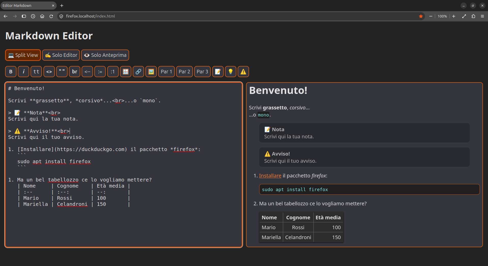
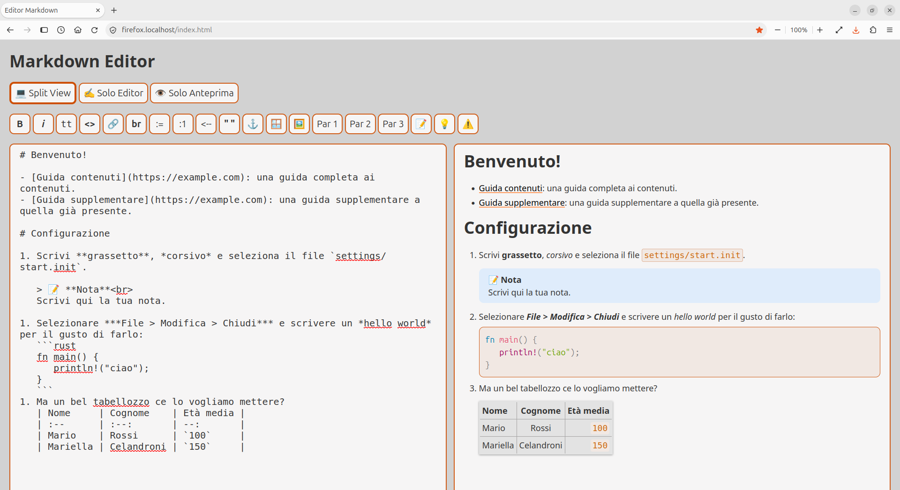

# md-editor

Testing/learning how to insert and customize a markdown editor into a `html` page.

> ⚠️ At the moment it'is just a learning project, NOT super tasted... take it in consideration before using it in production.

> 📝 I apologize if the example and a good part of the *html* interface is in Italian. I did so to make thing easier as this experiment could be use in an Italian project. At least it's very easy to change it!  😜

# How to test it

1. Download the repo folder.
2. Clic on the `index.html` file or open it with your browser.

While writing into the left edit area, you will immediately see the result into the right preview area. Single views of the edit and preview area are available.

- Some shortcuts available:
  - **Bold**: `Ctrl+b`
  - *Italic*: `Ctrl+i`
  - `Monospace` (tt): <code>Ctrl+`</code>
- The immage button uses *html* format. This makes pictures formatting much more flexible, directly controlling dimentions (`width="..."`) and alignment (`align="..."` *center/left/right*).
- The page theme follows the system theme:
  - Dark:
    
  - Light:
     

# More details

- Expectations: use as less javascript as possible avoiding the need of frameworks that require other frameworks.
- The `marked.umd.js` [file](https://cdn.jsdelivr.net/npm/marked@latest/lib/) from the [marked.js](https://marked.js.org/) project is the *markdown to html* parser.
- Inside `buttons_editor.js` are all the custom vanilla js functions to initialize the editor and make every button work.
- (Still work in progress!) Inside the [doc](https://github.com/jeremie2/md-editor/tree/main/doc) folder you'll find all the functions documented line by line.
- Except for the `js` files, then there are just an `index.html` and `style.css`... end of the game. The target is to have an easy customizable and still future rich editor able to produce client side previews.
